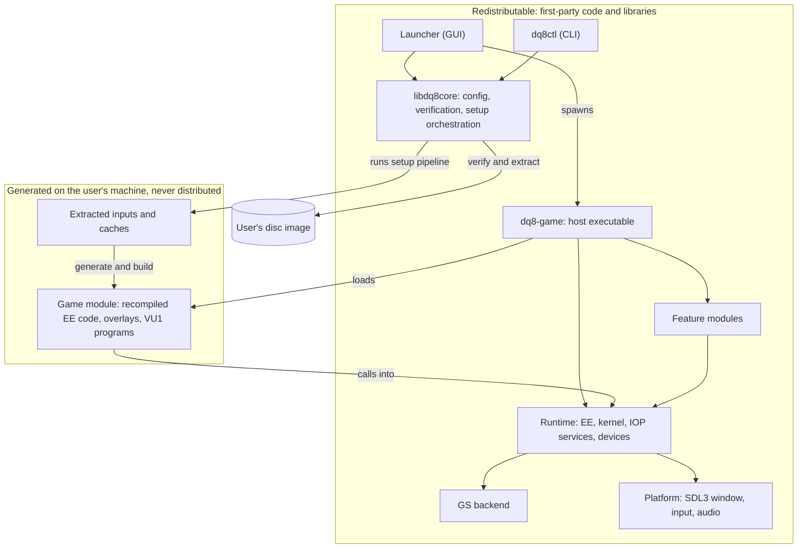
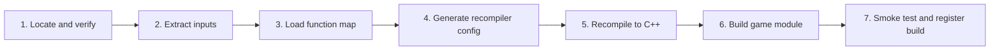
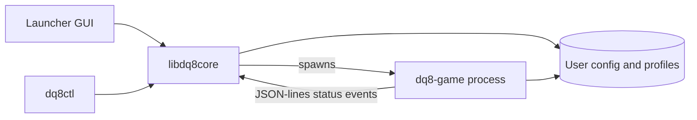
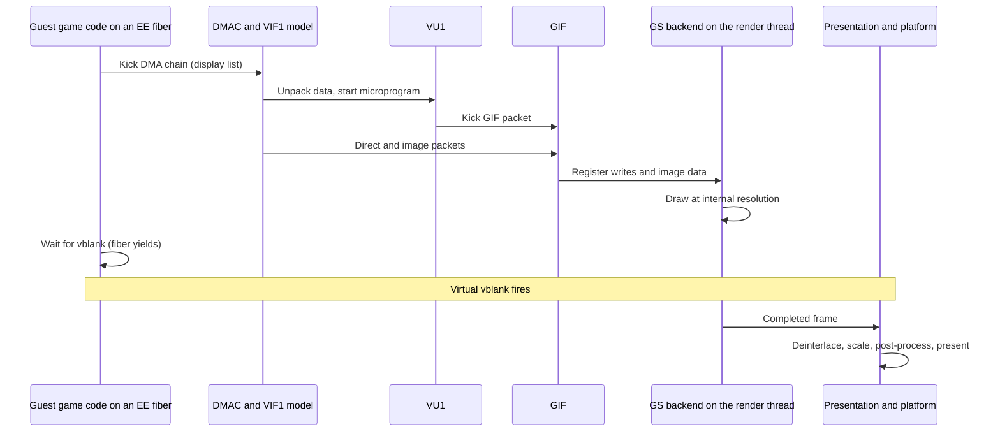
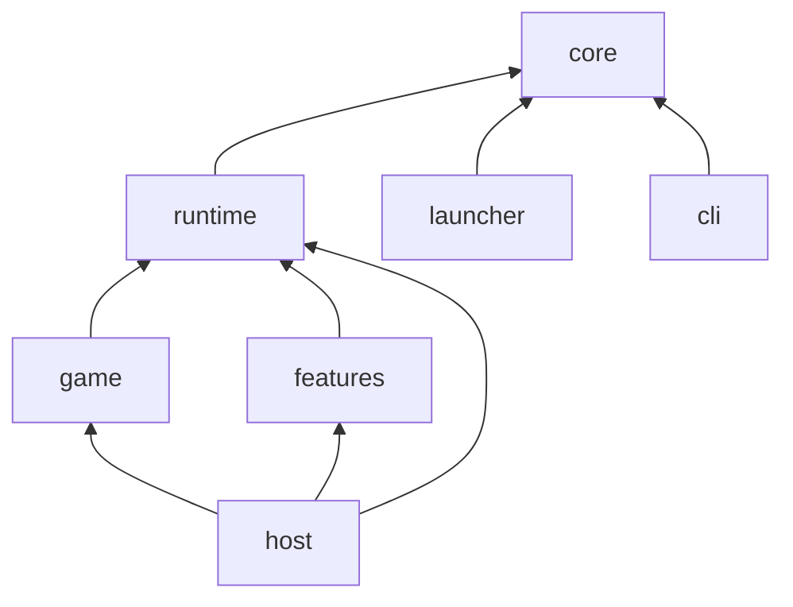

# Architecture: DQ8-Native

| | |
|---|---|
| **Status** | Proposed design. Nothing here is implemented yet, and every decision is revisable until it is recorded as accepted in §18. |
| **Last updated** | 2026-10-19 |
| **Read first** | [project-brief.md](project-brief.md) for goals, scope and the facts about the target disc |
| **Companion** | [tech-stack.md](tech-stack.md) for languages, libraries and tools |

**Contents:** 1 Principles · 2 System overview · 3 Setup pipeline · 4 Guest execution model · 5 Machine services · 6 Graphics · 7 Audio and movies · 8 Input, saves, disc · 9 Settings · 10 Features and patches · 11 Launcher and CLI · 12 Frame flow and threading · 13 Repository layout and module rules · 14 Legal safeguards · 15 Testing · 16 Observability · 17 Extension points · 18 Decision log · 19 Open questions · Appendix A Glossary

---

## 1. Principles

These principles settle most design arguments. When a proposal conflicts with one, change the proposal or change the principle here first.

| # | Principle | Consequence |
|---|---|---|
| P1 | **Bring your own game, always.** Nothing derived from the disc is committed or distributed. | The recompiled game is a locally built *game module*, separate from the redistributable host (§2). |
| P2 | **Native code over emulated hardware.** Implement what this game uses, at the level it uses it. | Packet-level DMA, native pad and memory card, HLE kernel. No cycle accuracy, no BIOS. |
| P3 | **Faithful first, enhanced second.** The default configuration reproduces the original game. | Enhancements are feature modules, off by default or clearly labelled (§10). |
| P4 | **Interfaces at every seam that will have a second implementation.** | GS backend, audio sink, input source, disc source, platform, feature, front end (§17). |
| P5 | **Deterministic core.** Game-visible time derives from a virtual clock, never from wall-clock or thread timing. | Reproducible tests, replay, and a path to netplay or rewind. |
| P6 | **Data-driven where it scales.** Settings, region profiles, function maps and patches are data files, not code. | Adding a setting, region or patch does not touch the launcher or the runtime. |
| P7 | **Prove it against the original.** Every translated or replaced piece can be checked against a reference. | Reference interpreter, oracle tests and GS replay (§15). |
| P8 | **Observable by default.** Failures produce actionable reports. | Tracing, structured logs, unresolved-code reports (§16). |
| P9 | **Strict layering.** Dependencies point one way (§13). | The launcher can be replaced without touching the runtime, and the runtime can be tested without a window. |

---

## 2. System overview

### 2.1 The central split: host and game module

The product has two parts with different legal and operational properties.

| | **Host** | **Game module** |
|---|---|---|
| Contains | Launcher, CLI, runtime, renderers, features, platform layer | The recompiled game: EE code for the main program and each overlay, function tables, optionally compiled VU1 programs |
| Written by | Us | The recompiler, from the user's disc |
| Distributed | **Yes**, as ordinary release binaries | **Never.** Built on the user's machine |
| Changes when | We release | The disc, the function map, the recompiler version or the module ABI changes |
| Loaded as | The `dq8-game` executable | A shared library that `dq8-game` loads at start-up through a small, versioned C ABI |

A release of the host therefore does not force a rebuild of the game module unless the module ABI version
changes. The ABI is deliberately narrow (§13.3) and is versioned independently of the product.

### 2.2 Component view



### 2.3 What replaces what

| PS2 component | Native replacement | Where |
|---|---|---|
| EE CPU (R5900) | Recompiled C++ in the game module, plus a reference interpreter for tests and fallback | §4 |
| EE kernel (syscalls, threads, interrupts) | HLE in the runtime | §5.1 |
| IOP CPU and its modules | Execution of original IRX modules at first, replaced by native services module by module | §5.2 |
| DMAC, VIF, GIF | Packet-level functional model | §5.3 |
| VU0, VU1 | Helpers for VU0 macro mode; interpreter and then ahead-of-time compilation for VU1 | §4.4, §5.4 |
| GS | A pluggable backend (paraLLEl-GS first, native renderer later) | §6 |
| SPU2 | Software mixer feeding the host audio API | §7 |
| IPU, movies | MPEG decoding on the host | §7 |
| CDVD | Disc-image reader with optional latency modelling | §8.3 |
| Pad and memory card | Native services over host input and a save folder | §8.1, §8.2 |
| PS2 BIOS | Not used | n/a |

---

## 3. Setup pipeline

First-time setup turns a user's disc image into a runnable game module. It is implemented once in `libdq8core` and driven by both the launcher and `dq8ctl`.



| Stage | Input | Output | Notes |
|---|---|---|---|
| **1. Locate and verify** | Disc image path | Verified region profile | Reads ISO 9660 directly. Finds the boot file from `SYSTEM.CNF`, hashes it, and looks the hash up in `data/regions/`. **Unknown hash means stop**, with an actionable message (modified image, other region, bad dump). Also checks free disk space and toolchain availability. |
| **2. Extract inputs** | Disc image | `baserom/<profile>/` with boot ELF, overlay files, IOP modules | `DATA.DAT` and `DATA2.DAT` are *not* extracted. The runtime reads them from the image (§8.3), which saves several gigabytes. The overlay container (`MWo3`) is parsed here into per-overlay code and data. Spike S4 confirmed that the game reads archive members by sector itself, so nothing in the archives is needed at build time; the `.HD6` indexes are optional tooling inputs. |
| **3. Load function map** | Region profile | Merged function map per code unit | Maps are authored data in `config/functions/<profile>/` (one per unit: main, and each overlay). **End users never run Ghidra.** Developers extend the maps with the analysis tools (tech-stack.md §7). |
| **4. Generate recompiler config** | Function maps, stub and patch lists, template | One TOML config per code unit | The template, stub list and instruction patches are authored and versioned. Overlays get a config each. |
| **5. Recompile** | ELF, overlay code, config | Generated C++ per unit, in `generated/` | Pinned PS2Recomp recompiler (§4.7). Output is chunked into many files for parallel compilation and is **deterministic**, so the content hash is a valid cache key. |
| **6. Build game module** | Generated C++, runtime headers | `dq8_game_module` shared library | Compiled with the discovered or bundled toolchain (tech-stack.md §6). Parallel, with a compiler cache. Only changed chunks rebuild. |
| **7. Smoke test and register** | Built module | Entry in the local build registry | Loads the module, checks the ABI handshake and metadata (profile id, boot ELF hash, generator version), and records the build so the launcher can offer Play. |

**Properties every stage must have:**

- **Idempotent and resumable.** Each stage records the hash of its inputs and the tool version. If nothing changed, it is skipped. A cancelled run resumes where it stopped.
- **Progress and logs.** Structured progress events for the UI, and a full log file per run.
- **Fail loudly and early.** Verification happens before anything slow starts.
- **No network access** unless the user has explicitly enabled something that needs it.
- **Developer mode.** Developers can run one stage in isolation, override the function map, and keep intermediates.

**Time and disk.** Spike S1 measured the boot ELF on a 6-core machine: recompiling takes 2 s and produces 8,335 units
(201 MB of C++) under the heuristic map; compiling them costs about 15,000–16,000 CPU-s (30–40 minutes at 12 jobs),
about 6,000 CPU-s (≈15 minutes) with a precompiled header of the runtime headers; peak RAM 5–7 GiB at 12 jobs
(0.35 GiB per typical job, 2–3 GiB for the two largest units); about 0.5 GB of disk. Mitigations, each backed by a
number: the PCH (0.37× per unit), `-O2` for function units and `-O0/-O1` for the dispatch table, splitting the few
multi-megabyte units, a job count chosen from free RAM, and a compiler cache keyed on the deterministic output.

---

## 4. Guest execution model

### 4.1 Memory

- **One flat arena** for guest RAM (32 MB), plus a 16 KB scratchpad region and routed address ranges for device registers.
- Guest addresses are 32-bit. Kernel-segment mirrors of RAM are normalized by masking. Generated loads and stores take a **fast path for RAM** (mask, add base, access) and a slow path that dispatches to device handlers for register ranges.
- **No host pointer is ever stored in guest memory.** Host objects are referred to by handles that the guest treats as opaque integers. This keeps guest memory a pure function of guest behavior, which makes snapshots, differential tests and replay possible.
- Guest memory is little-endian, matching all supported hosts, so loads and stores need no byte swapping.
- Debug builds can place watchpoints on guest ranges and can detect writes into code ranges (spike S3 found no self-modifying code: zero write references into any code range from the main program or the six overlays, so all seven code units can be compiled ahead of time and the window treated as read-only code between loads).
- At start-up the runtime loads the boot ELF segments into guest RAM from the user's image. The code bytes stay in guest memory because the game may read its own data and tables; the code that **executes** is native.

### 4.2 Functions and dispatch

- Each guest function becomes one native function that receives the **EE register context** (128-bit GPRs, HI/LO, FPU registers and flags, the VU0 register file, program counter) and the guest memory arena.
- **Calls go through dispatch.** PS2Recomp at `eb8688b` routes every `jal` through `dispatchGuestBranch` (61,529 sites in the heuristic output); only a `j` to a function of the same code unit becomes a direct native call. A same-unit `jal` fast path is a candidate patch-queue item once profiling (M3) says it matters.
- **Indirect calls and returns** (`jalr`, `jr`) go through a **flat dispatch table** indexed by guest address. The table covers the main program's code range and the overlay window (§4.3). Returns normally use the native call stack. The dispatcher handles the cases where guest code manipulates the return address (tail calls, coroutines, stack switching).
- **Switch tables** (computed `jr` inside a function) must be resolved at analysis time and emitted as native `switch` statements. Unresolved ones are reported (§4.6). Spike S2 measured the load on this path for the main program: 121 of 152 computed jumps have a resolved table, 31 do not, and 993 of 1,124 `jalr` sites have no static target.
- **Unknown target.** A dispatch to an address with no function logs the address into the *unresolved-code report* and then either stops with a diagnostic or falls back to the interpreter (§4.6), depending on a setting.

### 4.3 Overlays

The six `BIN/*.BIN` overlays (battle, casino, menu, shop, title, viewer) all load into the same window at
`0x00461C80`, one at a time. This is the main structural difference from the flat programs that existing
recompilers assume, so it is designed in from the start.

**Compile time.** Each overlay is a separate **code unit** with its own function map, its own generated sources and its own namespace. Calls inside a unit are direct. Calls between the main program and an overlay, and between overlays, always go through dispatch. Spike S1 confirmed the mechanics: the recompiler silently ignores the six zero-filesize segments (a map entry inside the window is dropped as "outside executable sections"), so each overlay must reach it as its own synthetic ELF whose section covers the window with real bytes, and each run emits its own flat dispatch table (`register_functions.cpp`, one slot per 4 bytes) under the same symbol names, which must be prefixed per unit before six units can link into one image.

**Run time.** An `OverlayManager` owns the answer to "which overlay is resident?".

| Responsibility | Mechanism |
|---|---|
| Know when an overlay becomes resident | **Primary (S3):** replace the loader `0x00100330` with a native implementation that reads the file from the image into guest RAM at `dest`, tells the manager which overlay is now resident (name-table index or the resident `overlay_id`), repoints the window's dispatch slots **before** returning (the loader itself then runs the constructor table through `jalr`), zeroes bss and returns 1. **Cheaper variant:** hook the empty `0x00100320(dest)` that the game calls after the read and before the flush. **Fallback:** read `overlay_id` at `window + 4`; the header stays resident and nothing ever writes the window. |
| Route dispatch | Each unit has its own table (`table_base` to `table_end`, which for an overlay lies inside the window but need not start at its base). The dispatcher looks a pc up in the main table, else, if the pc is inside the window, in the resident overlay's table, else reports a miss; with no overlay resident a window pc is a diagnostic stop (`OverlayManager::describe_miss`). |
| Keep guest memory honest | The loader still places the overlay bytes in guest RAM exactly as the game expects, because overlay files contain data as well as code. Only the *execution* is native. |
| Detect desynchronization | Debug builds periodically verify the resident bytes against the expected fingerprint and report a mismatch. |
| Handle stale returns | A return into an overlay that has been replaced is a guest bug that the original game never exhibits. Debug builds detect it with a generation counter on the call stack. |

**Region handling.** Each region profile lists its overlays, window address and fingerprints. Nothing in the runtime hardcodes `0x00461C80` or the overlay names.

**What spike S3 established.** Overlays never load overlays and contain no syscalls; the 12-mode state machine in `0x001693B0` (mode variable `0x003D2740`) plus 13 constant-index load sites are the only switch logic. Code exists inside the overlays' *data* ranges (constructor thunks, vtable targets), so the per-unit function maps decide what is code, not the header's `text_size`. 168 direct `jal` sites in 43 main functions target 120 window entries, and 63 pointer-table words in main data (the mode init/update/exit tables among them) are the other entry mechanism; the constructor walk `0x00100DE0` calls overlay code through `jalr` immediately after a load. A dispatch range of at most 40,832 slots covers the window. The main program was linked against each overlay's addresses, so a call into the window is valid only while the right overlay is resident; the generation counter in debug builds catches the rest.

### 4.4 Arithmetic fidelity

Small numeric differences can desynchronize or hang console games, so arithmetic is implemented through dedicated helpers instead of plain host operators.

| Area | Requirement |
|---|---|
| **Integer** | Wrap-around semantics, 32-bit results sign-extended into 64-bit registers where the architecture says so, 128-bit GPRs, multimedia (MMI) instructions through SIMD helpers with a portable fallback. |
| **EE FPU** | Single precision, **not IEEE-754**: results round toward zero, denormals flush to zero, and there are no NaN or infinity encodings (overflow saturates). Implemented with helpers that control the host rounding mode and clamp results. |
| **VU0 macro mode** | COP2 instructions inside EE code call vector helpers with the same float semantics. |
| **Conversions and division** | Dedicated helpers for `cvt`, `div`, `sqrt`, `rsqrt`, which also differ from IEEE behaviour. |

Helpers are tested bit-for-bit against a reference implementation (§15). A "fast" arithmetic mode may be considered
later, only if measurement shows a need, and only as an explicit non-default setting.

### 4.5 Overrides

An **override** replaces or wraps a guest function with native code.

| Kind | Purpose |
|---|---|
| **Replace** | Native implementation instead of the recompiled one (for example fast `memcpy`-style routines, or a function ported by hand during decompilation work). |
| **Hook** | Run native code before or after the recompiled function (tracing, widescreen adjustments, input injection). |
| **Redirect** | Route a guest library call to a runtime service (file read, memory card, sound RPC). |

Overrides are keyed by **(region profile, code unit, guest address)** and registered at module load. Each
override documents the original function's behavior and has an oracle test where feasible (§15). This extends
PS2Recomp's per-build "game override" mechanism to be overlay-aware. Overrides are also the migration path to
readable code: a function ported by hand replaces its generated counterpart and the test proves equivalence.

### 4.6 Unresolved code and the reference interpreter

The runtime includes a **reference EE interpreter** operating on the same register context and memory arena as the recompiled code. It has three jobs:

1. **Oracle** for differential tests (§15).
2. **Fallback** for guest addresses with no recompiled function, so the game can keep running while the miss is recorded.
3. **Tool** for debugging (single-step, trace).

Every fallback is logged to the unresolved-code report with the address, the caller and the overlay. That report is
the input to the next round of function discovery. The fallback is a development aid and is disabled in release configurations by default.

### 4.7 Relationship to PS2Recomp

PS2Recomp supplies the recompiler (R5900 to C++, configuration, stubs and patches). We use it as a **pinned
dependency with an ordered patch queue** (`patches/`) and write our own runtime. Reasons: the project is experimental,
reports poor VU and GS performance and partial hardware coverage, and has no overlay concept. Fixes go upstream whenever possible.
Other PS2 ports have converged on replacing hardware with native code rather than emulating it, and our runtime
follows that model. The decision is tracked as ADR-0003.

---

## 5. Machine services

### 5.1 Kernel (HLE)

The EE kernel is implemented in the runtime, not executed. Syscalls arrive as calls with an ID and register arguments.

- **Coverage order:** thread and semaphore control, event flags, alarms and timers, interrupt handler registration, cache flush (a no-op, but overlay-relevant), memory and heap services, program loading, and the SIF layer that carries RPC to the IOP. Spike S2 found 78 `syscall` sites with 65 distinct numbers in the main program (54 positive, 11 negative interrupt-context variants) and 51 SDK-named kernel-call stubs; that list (`work/ghidra/base/census-base.csv`) is the initial HLE coverage target. The first overlay load happens before the title screen, so the file-I/O RPC (`open`/`lseek`/`read`/`close` by `cdrom0:` path) must be HLE'd early; `FlushCache(0)`/`FlushCache(2)`, the only cache calls on that path, and `sceCdSeek` are no-ops for us (S3).
- **Unimplemented syscalls** log and stop in development builds. They never silently return success.
- **Thread semantics** are described in §12.

### 5.2 IOP

The IOP is a separate MIPS processor that runs the IRX modules on the disc and serves the EE over SIF RPC. We stage the work:

| Stage | Approach | Reason |
|---|---|---|
| **A. Bootstrap** | Execute the original IRX modules on an IOP interpreter with a minimal IOP kernel, using PS2Recomp's IOP executor or our own. | Preserves the behavior of the game's own `SK*` and `PCMPLAY` sound modules while we are still learning them. |
| **B. Native services** | Replace the standard Sony modules (pad, memory card, CD streaming, SIO2, `LIBSD` and `SDRDRV` at the register level) with native services that answer the same RPC. | Pad, saves and disc access get host-native behavior, which the launcher's features depend on. |
| **C. Sound HLE** | Replace the game-specific sound modules once their interface is understood, or compile them ahead of time. | Performance and removing the IOP interpreter from the hot path. |

The IOP runs on the machine thread in virtual time (§12) at first, and can move to its own thread with synchronization at SIF boundaries if profiling demands it.

### 5.3 DMA, VIF and GIF

The game builds **display lists as DMA chains** in guest memory, so a DMA model is unavoidable. We implement it at the **functional, packet level**:

- DMAC channels the game uses (VIF1, GIF, SIF, IPU, scratchpad) walk chains and deliver data.
- VIF decodes VIFcodes (unpack, microprogram calls, direct transfers) and feeds VU1 memory.
- GIF decodes tags and forwards register writes and image data to the GS backend.
- No cycle timing. Completion is signalled at deterministic points in virtual time.

### 5.4 VU1 and VU0

VU1 transforms geometry and emits GIF packets. Microprograms are **uploaded at run time from game data**, so they
cannot all be found by reading the ELF.

| Stage | Approach |
|---|---|
| **1. Interpreter** | A correct VU interpreter. Always available and used as the fallback for any program not yet compiled. |
| **2. Ahead-of-time compilation** | The runtime records each unseen program by content hash into a *program census*. A tool in `tools/vu1/` compiles census programs to C++ (as other ports do), and the result is linked into the game module or a companion library. Programs are matched by hash at run time, and anything unmatched falls back to the interpreter. The census is a local, user-generated artifact (it derives from game data) and is never committed. |
| **3. Optional JIT** | Evaluate only if stage 2 is insufficient. |

The launcher can offer an "Optimize" action that rebuilds the compiled VU1 set from the census gathered from the user's own play. Correctness never depends on it.

VU0 macro mode is handled inside the EE code path (§4.4) and is used heavily (spike S2: 1,234 COP2 macro ops plus 954 `lqc2`/`sqc2`). VU0 micro mode is used at exactly two `vcallms` sites, so the VU0 microprogram path cannot be skipped but may stay an interpreter. S7's save states show VU0 microcode loaded by the title screen with VU0 data memory still zero, so those programs run later (battle is the likely place).

### 5.5 Timers and interrupts

Vblank, hblank, timer and DMA interrupts are generated from the **virtual clock** (§12). The vblank rate follows the
disc's video mode (`VMODE = NTSC`, so 59.94 Hz for the signal). The game's actual update rate is measured in spike S7.

---

## 6. Graphics

### 6.1 Backend interface

The GS is the largest and riskiest component, so it sits behind one interface (`IGsBackend`). The runtime hands it **register writes and image transfers from the GIF**, plus the **vertical-sync and display-output events**. The backend returns rendered frames and capabilities.

| The backend is told | The backend reports |
|---|---|
| GS register writes (with their order) | Supported internal scale factors |
| Image data uploads to and downloads from GS memory (host-to-local transfers, local-to-host readbacks, direct VRAM access for save states) | Whether it can capture draw lists, replace textures, or support widescreen |
| Writes to the privileged register page (PMODE, SMODE, DISPFB, DISPLAY, CSR, IMR, …), copied in at vsync | Which interrupt conditions it raises itself (parallel-gs raises none: FINISH, SIGNAL, LABEL and vsync bits are the runtime's job) |
| Display and CRTC configuration, field and frame boundaries | Required GPU features, and whether the current device meets them |
| Reset, settings changes, shutdown | Frame completion and timing statistics |

### 6.2 Backends

| Backend | Technology | Provides | Limits | Plan |
|---|---|---|---|---|
| **parallel-gs** | paraLLEl-GS, Vulkan compute, LGPL-3.0-or-later, linked as a shared library | The most accurate GS emulation available to us. 2x to 16x supersampling. Works from the GS register stream. | Needs specific Vulkan features (descriptor indexing, timeline semaphores, 8 and 16-bit storage, scalar block layout, subgroup size control). Also needs `bufferDeviceAddress` and 32 KiB of compute shared memory (S5a). It models GS memory, so scene-level features (widescreen, interpolation, texture identity) are limited. Small embedding API (`GSInterface`, about 25 methods), proven headless in spike S5a; all calls must come from one thread, the renderer owns one helper thread, and host readbacks block the caller. Wrapper estimated at 1,000–1,500 lines. Reads PCSX2 dumps of state version 8–9, uncompressed only. **Verified on this game (S5b):** SSIM 0.992–0.997 against PCSX2's software renderer on field, menu, movie and settings frames; 5 ms of GPU per field frame at 1x and 18.5 ms at 16x on the RTX 4060; a real 2x picture through backbuffer promotion, super-sampled textures and high-resolution scanout; about 8 ms of CPU per field frame for GIF decode on one thread. | **First backend**, targeted at M3 |
| **trace** | None: records packets to a dump file | Headless operation, replay input for tests and golden frames | Draws nothing | Early, for CI and tests |
| **native** | Our own renderer over Vulkan (with OpenGL later if needed) | Render at any resolution, true widescreen, texture replacement, draw-list capture for interpolation, lighter GPU requirements | Must model GS framebuffer, texture and blending semantics. Large effort. Clean-room under our license, with no code copied from paraLLEl-GS. | Long-term, after M6. Research can start earlier. |

A hidden backend that has not passed parity checks against the reference must never be selected automatically.

### 6.3 Presentation pipeline

```
GS output frame or field
   -> deinterlace (weave, blend, bob)
   -> scale (nearest, bilinear, integer, FSR 1 + RCAS)
   -> aspect fit (4:3, stretch, pillarbox, integer)
   -> post effects (sharpen, CRT, user shaders)
   -> overlay UI (menu, FPS graph)
   -> swapchain
```

- **Two different scales.** *Internal resolution* is how big the backend renders (supersampling for parallel-gs, true resolution for native). *Output scaling* is how that image is stretched to the window. Both are settings.
- **Presentation runs at the host refresh rate** and is decoupled from the game's update rate (§12). Dropping presented frames never drops game vblanks.
- **What the output stage must reproduce (S7):** the game runs the CRTC field-interlaced with two circuits merged through PMODE (50/50 blend, one-line offset) over a 24-bit display buffer blitted from a 32-bit target; parallel-gs does this already, and the native renderer must from day one, together with framebuffer-as-texture, 16-bit targets with channel masks and texture/depth memory aliasing. Mipmaps, dithering and readbacks can wait.

### 6.4 Widescreen and texture replacement

Both are **feature modules** (§10) that depend on backend capabilities, so they degrade cleanly on a backend that cannot support them.

- **Widescreen** (research): change the projection and viewport through memory patches or hooks, handle HUD placement and culling, and ask the backend not to stretch. Expected to need the native backend for a clean result.
- **Texture replacement:** hook the point where texture data is uploaded to GS memory, key it by a content hash, and substitute host-side images. First-class on the native backend. On parallel-gs it needs an upload-time hook and may be limited.

---

## 7. Audio and movies

### 7.1 Audio path

```
Guest sound drivers (IOP modules or HLE)
   -> SPU2 model: 48 voices per core, ADPCM decode, envelopes, reverb
   -> mixer
   -> resampler
   -> host audio stream (SDL3)
```

- The SPU2 model is a **software mixer** whose output is pulled by the host audio callback. Latency is a setting.
- Mixer timing follows the virtual clock so that audio, vblank and sound-driver behavior remain consistent when the game is throttled or fast-forwarded. Fast-forward may drop or time-stretch audio, but never desynchronizes the driver.
- The game-specific `SK*` and `PCMPLAY` modules decide how music and effects reach the SPU2. How they are driven (disc streaming versus sound banks) is learned during stage A of §5.2.
- Movie audio (spike S6b): the game copies 16-bit PCM into an IOP ring and drives `PCMPLAY.IRX` over SIF RPC (channel set-up, start, position query, stop, volume) and SIF DMA; the sound-stack HLE must offer that server and mix 48 kHz PCM. Video and audio run open-loop in the original game.

### 7.2 Movies

Spike S6a identified the `MVI` container (`Docs/formats/mvi.md`): a standard MPEG-2 program stream in 16 KiB packs, XORed with a 2,048-byte table the game generates at run time; MPEG-2 Main profile video at 512 × 448, 30 fps, progressive; 16-bit PCM stereo audio carried as a Sony ADS stream in private stream 1; `_W` files are anamorphic 16:9 renders. The IPU decodes the video on the PS2. The plan:

- **No decryption in the runtime.** Spike S6b found that the XOR table is generated and applied by the game's own read routine from data in the ELF, so the recompiled game decrypts the stream itself; the runtime only serves raw `.MVI` bytes to the game's file reads. (The S6a recovery method remains a tool for tests.)
- **HLE at the `sceMpeg` library boundary** (proposed; ADR when the runtime design is accepted): the library entry points S6b identified (`sceMpegCreate`, `AddCallback`, `AddStrCallback`, `DemuxPssRing`, `GetPicture`, `IsEnd`, `Reset` and the IPU init) are overridden so that the game's own demux ring, threads, GIF uploads (896 RGBA32 16 × 16 tiles per frame into its `moviework` buffer) and PCM feed keep running while `GetPicture` is served by a host decoder. The alternative, HLE at the IPU and DMAC level (channels 3 and 4, the IPU command set, macroblock-order RGBA32 output), is what emulators do and is far larger.
- Decode through an `IMovieDecoder` interface (MPEG-2 Main profile 512 × 448 is all that is needed), so a decoder library (tech-stack.md §5) can be swapped. Audio needs no decoder: the game pushes PCM16 to `PCMPLAY.IRX` (§7.1) and ignores the 48,048 Hz header field.
- Presentation: the player draws the frame pixel-for-pixel into the 512-wide frame buffer and relies on the CRTC's 4:3 or 16:9 stretch, selected by the game's screen-size byte; our presentation pipeline applies the same stretch, never the MPEG aspect code.
- Route movie audio through the same mixer as game audio.

---

## 8. Input, saves, disc

### 8.1 Input

```
Physical device (SDL3 gamepad or keyboard)
   -> mapping layer: profile, bindings, dead zones, response curves
   -> virtual DualShock 2 state
   -> pad service (replaces PADMAN at the RPC level)
   -> guest reads pad data through its normal library calls
```

- The game still believes it talks to a DualShock 2 through its library. We answer those requests natively.
- **Profiles** are stored per device and per user profile, and can be switched in the launcher or in-game.
- **Hot-plug** is handled in the platform layer and surfaced as an event the game sees as a pad connect or disconnect.
- Pressure sensitivity and rumble are modelled in the virtual pad and populated only where the host device supports them.

### 8.2 Saves

- The memory card is a **folder on disk** per profile and slot, served by a native implementation of the memory card RPC (replaces `MCMAN` and `MCSERV`).
- **Atomic writes** (write to a temporary file, then rename) and rolling backups protect against corruption.
- Import and export of standard PS2 memory card images is a P1 feature.
- No save data ever leaves the user's machine.

### 8.3 Disc access

`IDiscSource` abstracts the disc. Implementations: an ISO 9660 image reader (primary), and a directory of extracted files (developer convenience).

- The runtime reads `DATA.DAT` and `DATA2.DAT` **directly from the image** by sector, so no multi-gigabyte extraction is needed. Spike S4 recorded the access pattern: one `sceCdSearchFile` per archive at start-up, then `sceCdRead` of 1 to 512 sectors at `LSN + sector` with `sceCdSync(0)` and `sceCdGetError` polling (plus `sceCdSeek` from the overlay loader); the `.HD6` indexes are read through the file-I/O RPC at boot. The disc model therefore needs random sector access by LSN and the ISO directory, and latency modelling can key on (LSN, count).
- **Latency modes:** *Accurate* models disc timing, which some games depend on. *Fast* completes reads immediately (shorter loading). Both complete reads at deterministic points in virtual time.
- Reads are asynchronous and cancellable, served from a dedicated I/O thread.
- The overlay window ends where the heap begins (`0x00489A80`); nothing else is ever placed in the window (S3).
- Compressed image formats are out of scope for 1.0.

---

## 9. Settings and configuration

### 9.1 Layering

Later layers override earlier ones:

1. Built-in defaults from the **settings schema**
2. System-wide configuration (packagers only)
3. User configuration
4. Per-profile and per-game overrides
5. Command line (`--set key=value`) and environment variables (for development)

### 9.2 Schema-driven settings

Every setting is declared once, in the **settings schema**, owned by either the core or a feature module.

| Field | Meaning |
|---|---|
| `key` | Namespaced, for example `display.internal_scale` |
| `type`, `range` or `choices`, `default` | Validation and defaults |
| `label` and `description` | String-table keys, so the UI can be localized |
| `category`, `advanced` | Where and how the launcher shows it |
| `requires_restart`, `hot_reload` | Whether it applies live |
| `requires` | Backend capabilities or platform that must be present |
| `owner` | `core` or a feature id |

The launcher renders the settings pages **from the schema**. A new feature declares its settings and they appear, with no launcher change (P6). The runtime reads the same schema to validate values and apply defaults.

### 9.3 Storage

- Format: TOML, with a `schema_version` and migration steps between versions. Unknown keys are preserved, not dropped.
- Location: the platform's user configuration directory, or next to the executable when a `portable` marker file is present.
- Input bindings live in separate per-profile files so they can be shared and backed up independently.
- Settings never contain game content, and the file is safe to attach to a bug report.

---

## 10. Features and patches

### 10.1 Feature modules

A **feature** is an optional enhancement implemented against public runtime interfaces. Features are compiled in at first (trusted code), and can later be loaded dynamically against a versioned ABI.

| A feature can | Through |
|---|---|
| Declare itself, its version, dependencies and settings | A manifest read at start-up |
| Run at lifecycle points (load, game start, frame begin and end, shutdown) | The feature interface |
| Hook or replace guest functions | The override registry (§4.5) |
| Apply memory patches | The patch system (§10.2) |
| Observe or filter input | An input filter hook |
| Observe GS traffic | A GS observer hook |
| Add a post-processing pass | The presentation pipeline (§6.3) |
| Add UI panels to the overlay menu | The overlay API |
| Declare required backend capabilities | The manifest, so it is disabled with a clear reason where unsupported |

| Candidate feature | Needs |
|---|---|
| Widescreen | Patches, GS viewport control, ideally the native backend |
| Texture dump and replacement | Texture-upload hook, native backend preferred |
| Frame interpolation | Draw-list capture (native backend), scene state |
| Cheats and memory patches | Patch system |
| Fast-forward | Virtual clock control |
| Fast loading | Disc latency mode |
| Overlay menu, screenshots | Overlay UI, presentation tap |
| Input enhancements | Input filter hook |
| Auto-backup of saves | Save-store hook |

### 10.2 Patch system

A **patch** is a declarative description of a guest memory change or function override, stored as data.

- Targets a region profile, a code unit and an address, and may depend on a setting.
- Carries only **our** replacement values. Any "expected original" check is a **digest of the region**, never the original bytes, so patch files obey the no-game-data rule (§14).
- Applied at defined times (module load, overlay load, or on demand), because an overlay patch must be reapplied whenever that overlay becomes resident.
- The first runtime write is proposed in ADR-0013: a guarded write at vblank, from profile data, of a value the game itself writes (`--movies skip` moves TITLE's flyover timeline to its end). It should become a patch kind once this system exists.
- Community cheat and patch files in common formats can be **imported at run time** from the user's own files, with warnings for anything unsupported. They are never committed.

---

## 11. Launcher and CLI

### 11.1 Process model



- **The launcher and the game are separate processes.** A crash in one does not take down the other, GPU contexts stay separate, and the launcher can show the reason a game exited.
- The launcher starts the game with arguments (profile, config path, event channel). The game emits **structured status events** (started, module loaded, first frame, FPS, warnings, errors, exit reason).
- `libdq8core` exposes setup, verification, build registry, settings and process control as a typed API with progress streams. The GUI and the CLI are two thin front ends over it, so a different toolkit, or a web front end, can replace the GUI without changing behaviour (ADR-0010).

### 11.2 Screens

| Screen | Contents |
|---|---|
| **First run wizard** | Choose the disc image, verify it, check the toolchain (installed, bundled or instructions), run setup with progress and a log view |
| **Play** | The registered builds and profiles, a Play button, last-run status, and any issue the last run reported |
| **Settings** | Generated from the schema: Display, Graphics, Audio, Input, Enhancements, Advanced, Paths |
| **Controllers** | Device list, live input test, bindings, profiles, dead zones, rumble test |
| **Diagnostics** | Log viewer, GPU and Vulkan capability report (including whether the parallel-gs requirements are met), one-click support bundle |
| **About** | Version, third-party notices and licenses, legal notice |

### 11.3 CLI

`dq8ctl` offers every operation the launcher does (verify, setup, build, run, settings get and set, diagnose, clean) with machine-readable output. It is the interface for CI, scripting and headless machines, and the way developers run one setup stage in isolation.

### 11.4 Errors and updates

- Core errors carry stable codes and map to user-facing text with a suggested action ("The disc image does not match any supported release. It may be a different region, a modified image or a bad dump.").
- Update checking is **opt-in**, makes at most one anonymous request, and is off by default. There is no telemetry.

---

## 12. Frame flow and threading

### 12.1 Frame flow



### 12.2 Threads

| Thread | Role |
|---|---|
| **Machine thread** | Runs EE guest code, the IOP, the DMA model and the virtual clock on **one host thread**, in virtual-time slices. Determinism (P5) comes first. |
| **Render thread** | Consumes the command queue from the GIF and drives the GS backend. The parallel-gs backend requires all its calls from one thread and blocks that thread on host readbacks (S5a), so this is the only thread that touches `IGsBackend`. GIF decode alone costs about 8 ms of CPU per field frame in parallel-gs (S5b), so this thread is mandatory, not an optimisation. |
| **Main thread** | Window events, input polling, presentation. |
| **Audio thread** | Pulls from the mixer through the host audio stream. |
| **I/O thread** | Disc reads and save writes. |

Further parallelism (IOP on its own thread, parallel VU work) can be added later with explicit synchronization points, but it is added only after profiling and without breaking determinism.

### 12.3 Guest threads and interrupts

- Each guest (EE) thread runs on its own **fiber**, with its own native stack, so a blocking syscall is a fiber switch.
- A **scheduler** reproduces the EE kernel's priority rules (lower number runs first, rotation at equal priority, preemption at defined points).
- Recompiled code cannot be interrupted at an arbitrary instruction, so **interrupts and preemption are delivered at safe points**: syscalls, function calls into the dispatcher, and cooperative yield checks that cheaply test a pending-interrupt flag. Where the checks go (function entry, loop back-edges) is a build option because it costs speed.
- Interrupt handlers (vblank, DMA, timers) run on their own fiber at the next safe point.

### 12.4 Clocks and pacing

- A **virtual clock** drives vblank, timers, audio mixing and disc completion. Wall-clock never reaches the guest. The game updates at 30 Hz (60 Hz in the main menu) over a 59.94 Hz field-interlaced signal (S7).
- A **limiter** ties virtual time to real time at a chosen speed (1.00x by default, fast-forward uncapped, slow motion below 1x).
- If the host cannot keep up, the policy is to **skip presenting frames**, never to skip vblanks or timer interrupts.

### 12.5 Performance approach

- Measure before optimizing: per-frame counters for dispatch misses, interpreter fallbacks, VU programs run, GS packets, and time in each stage.
- Hot-path rules: inline RAM access, flat dispatch tables, no virtual calls per guest instruction, generated code at `-O2` for hot units.
- As reference for the order of magnitude, another PS2 port reports about 11 to 13 ms per frame on VU1 and GS work alone, so the GS and VU1 stages are where the budget goes.
- Profile-guided optimization and link-time optimization are candidates once the code is stable.

---

## 13. Repository layout and module rules

### 13.1 Layout

```
Docs/                         Project documentation (this file, brief, tech stack; ADRs and game notes later)
include/dq8/                  Public headers. include/dq8/abi/ holds the versioned host/module ABI
src/
  core/                       Config, settings schema, logging, paths, hashing, disc image, verification, registry
  runtime/
    ee/                       Memory, register context, dispatch, overlay manager, reference interpreter
    kernel/                   Syscall HLE, scheduler, fibers
    iop/                      IOP execution and native IOP services
    dma/                      DMAC, VIF, GIF
    gs/                       Backend interface, parallel-gs wrapper, trace backend, native backend
    vu/                       VU interpreter, program census, compiled-program glue
    spu2/                     Mixer and voices
    io/                       Disc, memory card, pad services
    movie/                    Container demux and decoder interface
    platform/                 SDL3 window, input, audio
  game/                       DQ8-specific: overrides, patches, region profile loaders, overlay metadata
  features/                   Optional enhancement modules
  host/                       dq8-game executable
  launcher/                   dq8-launcher GUI
  cli/                        dq8ctl
tools/                        extract, ghidra, recomp (driver), vu1 (compiler)
config/                       Recompiler templates, function maps, settings schema
data/                         Region profiles (hashes, window addresses, overlay fingerprints), shape-only tables
patches/                      Patch queue for third-party sources
third_party/                  Pinned dependencies (submodules)
tests/                        unit, oracle (local only), fixtures (no game data)
packaging/  scripts/  cmake/  .github/workflows/
Game/                         Local only, git-ignored: the user's disc image
```

Generated and local-only directories (`baserom/`, `generated/`, `build/`, `saves/`, `logs/`) are git-ignored.

### 13.2 Dependency rules



- **`core` knows nothing about the PS2 or about any UI.**
- **`runtime` knows nothing about Dragon Quest.** Anything game- or region-specific lives in `game/` or in data files. If the runtime needs to ask "which overlay is this", it asks through an interface that `game/` implements.
- **`launcher` and `cli` depend only on `core`.** They never link the runtime. They talk to the game by spawning it.
- **`features` depend on public interfaces**, not on runtime internals.
- Enforced by separate CMake targets with explicit link lists, plus a CI check on include paths.

### 13.3 The module ABI

- Lives in `include/dq8/abi/` (`game_module.h`, plain C) with the C++ include root `include/dq8/abi/ps2recomp/` that generated code compiles against; no STL or C++ types cross the boundary.
- **Exceptions (temporary deviation, M2):** the host's `GuestStop` and the emitter's inline `throw` on unhandled instructions unwind through module frames, so host and modules share the C++ runtime (no static libstdc++; MSVC `/EHs /MD`). M3 replaces `GuestStop` with fiber switches (§12.3) and a patch-queue change to the emitter removes the inline throws; after that, nothing unwinds across the boundary.
- Contains: the register context layout (`R5900Context`), the descriptor each module exports through `dq8_game_module_describe` (unit kind and name, overlay id, profile id, source SHA-1, generator string, context size and alignment, entry point, dispatch table), the host API table that the generated code's `PS2Runtime` adapter forwards to, and the ABI version number (1 since M2).
- The host refuses a module with an incompatible ABI version and tells the launcher to rebuild.
- Changing the ABI is an event: version bump, changelog, and a note in the ADR log.

### 13.4 Conventions

- C++20. One namespace per layer (`dq8::core`, `dq8::rt`, `dq8::gs`, `dq8::features`, and so on).
- A short `README.md` in each top-level source directory explains its purpose and rules (already in place).
- Region profiles in `data/regions/<serial>.toml`, function maps in `config/functions/<profile>/<unit>.csv`, settings schemas in `config/settings/`. The overlay section of a region profile carries the loader facts from S3 (`code_offset`, `window_pointer`, `loader`, `loader_hook`, `load_by_index`, `name_table` and its order, `lsn_cache`, `ctor_walker`, `flush_cache_stub`, `mode_variable`) and, per overlay, `index`, `segment_index`, `memsz` and the header fields as integrity values.
- Decisions that change this document are recorded as ADRs in `Docs/adr/` (§18).

---

## 14. Legal safeguards

The brief (§9) states the policy. This is how it is enforced.

| Safeguard | Mechanism |
|---|---|
| **Nothing from the disc is tracked** | `.gitignore` for `Game/`, `baserom/`, `generated/`, disc image and archive extensions, and boot-file names. |
| **Pre-commit and CI check** | A script scans staged and tracked files for forbidden extensions and names, oversized blobs, and high-entropy binary files. If a disc is available locally, it also checks that no tracked file contains a long run of bytes from the disc's boot ELF (rolling-hash comparison). In CI, where no disc exists, only the heuristics run. |
| **Release artifact scan** | The release pipeline runs the same check over the produced archives. |
| **Region gate** | Setup refuses a boot file whose hash is not in `data/regions/`, so unknown builds are never mistranslated. |
| **Local generation** | The recompiled C++ and the game module are produced and stay on the user's machine. |
| **Shape-only data** | Tables in `data/` list labels, sizes and pointer slots without values. The runtime reads values from the user's disc at start-up. |
| **Game-derived values that never enter the repository or tool output** | The movie XOR table and the string, immediates, multiplier and seed it is generated from (game code produces it at run time); the HD6 dictionary strings and path records; overlay and archive bytes; decompiled or disassembled code. Docs and tools carry addresses, counts and layouts only. |
| **Contribution rules** | DCO sign-off, a checklist item in the pull-request template, and a ban on contributing from leaked or proprietary sources. |
| **Privacy** | No telemetry. Update checks are opt-in and send nothing identifying. Support bundles are assembled locally and reviewed by the user before sharing. |

**Open item for legal review.** The function maps in `config/functions/` record function start addresses, sizes
and names that we authored from analysis of the binary. Decompilation projects routinely publish such symbol
tables, and they contain no instructions or data, but this is the most derived artifact we commit and it should be reviewed before the first public release (brief §9).

---

## 15. Testing and verification

| Level | What it checks | Needs game data | Runs in CI |
|---|---|---|---|
| **Unit** | ISO 9660 reader on synthetic images, hashing, settings schema and migration, overlay manager logic with synthetic units, recompiler config generation, DMA, VIF and GIF parsers on synthetic packets, save-store atomicity, input mapping, FPU and MMI helpers against a reference implementation | No | Yes |
| **Oracle (differential)** | A recompiled or overridden function and the reference interpreter, run from the same register and memory snapshot, must end in the same state. Inputs are varied for functions that are pure with respect to memory. | Yes | No (local) |
| **GS replay** | A recorded GS packet stream replayed through a backend produces the expected image (hash, or perceptual difference within tolerance). Catches renderer regressions. Dumps can come from our trace backend or from the reference emulator. | Yes (dumps derive from the game) | Synthetic dumps only |
| **Boot and play scripts** | Scripted runs: boot, title, new game, a battle, menu, shop, save and reload, with timeouts and counter checks | Yes | No (local) |
| **Soak and performance** | Long runs watching frame time, memory growth and dispatch-miss counters | Yes | No (local) |

Further rules:

- **CI must pass with no game data.** Local suites are labelled and documented, and a failing local suite blocks releases, not pull requests.
- Fixtures in `tests/fixtures/` are synthetic. Captured snapshots and dumps stay out of the repository.
- Sanitizers (address and undefined-behaviour) run on the runtime and core. Generated code is exempt at first.
- Every override and every hand-written replacement needs an oracle test, or a note explaining why not.
- The reference emulator is used as ground truth for behavior questions, but its output is never committed as a fixture.

---

## 16. Observability

| Facility | Details |
|---|---|
| **Logging** | Categories (kernel, dma, gs, audio, io, setup, features), levels, per-run log files, structured fields. |
| **Guest tracing** | Optional function enter and exit ring buffer, syscall and RPC trace, DMA and GIF packet trace. Compiled in by a build option because it costs speed. |
| **GS capture** | A hotkey or CLI flag records the next frames' GS stream to a dump for replay (§15). |
| **Unresolved-code report** | Every dispatch miss and interpreter fallback is written with address, caller and overlay. It drives the next analysis round (§4.6). |
| **Crash reports** | Written locally with the guest program counter and call stack (symbolized from function maps), recent trace, settings and system information. |
| **Overlay diagnostics** | Resident overlay, last switch, verification result. |
| **Live overlay** | Frame time graph and counters (virtual FPS, presented FPS, dispatch misses, fallbacks). |

---

## 17. Extension points

This table is the practical meaning of "scalable". Each row says what to add and what must **not** need to change.

| To add | Implement or add | Must not need changes in |
|---|---|---|
| A **GS backend** | `IGsBackend` plus a registration entry | Runtime core, features, launcher (it shows the new backend through the capability report) |
| A **feature** | Feature interface plus manifest and settings schema fragment | Launcher UI code, runtime core |
| A **setting** | A schema entry | Launcher UI code |
| A **region or release** | Region profile, function maps, overlay table, hashes, patches | Runtime code |
| A **patch or cheat** | A patch data file | Any compiled code |
| A **game override** | A function registered by address in `game/overrides/` | The recompiler configuration, other overrides |
| An **audio sink or input source** | `IAudioSink` or `IInputSource` implementation | Mixer, pad service |
| A **disc source** | `IDiscSource` implementation (compressed formats, for example) | Everything that reads the disc |
| A **movie decoder** | `IMovieDecoder` implementation | Movie demux, IPU HLE |
| A **front end** | A new program over `libdq8core` | Setup logic, runtime |
| A **platform** | `IPlatform` implementation (window, input, audio) | Runtime |
| A **code unit** (overlay-like) | A function map and unit entry | Dispatch or the overlay manager's logic |

---

## 18. Decision log

Decisions are recorded as short ADRs in `Docs/adr/NNNN-title.md` as they are accepted. The first batch is proposed here. ADR-0009 was accepted on 2026-10-19, ADRs 0003, 0004 and 0008 on 2026-10-20, ADRs 0005, 0007, 0011 and 0012 on 2026-10-21 at the start of M3, ADRs 0014, 0015 and 0016 on 2026-10-21 at the start of M4, and ADRs 0006, 0010, 0017 and 0018 on 2026-10-22 at the start of M5 (files in `Docs/adr/`). ADR-0013 is proposed. The others still await the project owner's confirmation of the corresponding items in the brief (§14).

| ADR | Decision | Status | Rationale in one line |
|---|---|---|---|
| 0001 | Native port by static recompilation, not emulation, not matching decompilation | Proposed | Delivers a native game with feasible effort. Decompilation stays possible through overrides. |
| 0002 | Split into redistributable host and locally built game module over a versioned C ABI | Proposed | Keeps the legal boundary clean and avoids rebuilding the game on every host update. |
| 0003 | PS2Recomp as a pinned dependency with a patch queue, own runtime | **Accepted** (2026-10-20; `Docs/adr/0003-ps2recomp-pinned-dependency.md`) | Experimental upstream, no overlay support, we need control of the runtime. |
| 0004 | GS behind an interface, parallel-gs first, native renderer later, trace backend early | **Accepted** (2026-10-20; `Docs/adr/0004-parallel-gs-first-backend.md`) | Accuracy and resolution scaling now, flexibility later, testability throughout. |
| 0005 | SDL3 for window, input and audio | **Accepted** (2026-10-21; `Docs/adr/0005-sdl3-window-input-audio.md`) | Cross-platform, gamepad API, already used by sibling projects. |
| 0006 | Schema-driven settings and launcher | **Accepted** (2026-10-22; `Docs/adr/0006-schema-driven-settings.md`) | New features add settings without UI code. |
| 0007 | One deterministic machine thread with fibers, separate render, audio and I/O threads | **Accepted** (2026-10-21; `Docs/adr/0007-machine-thread-fibers.md`; minicoro behind `rt::Fiber`, virtual clock, cost model) | Determinism and testability before parallelism. |
| 0008 | Local setup build from the user's disc | **Accepted** (2026-10-20; `Docs/adr/0008-local-game-module-build.md`) | Only approach consistent with the legal stance. |
| 0009 | GPL-3.0-or-later | **Accepted** (2026-10-19) | Follows from using PS2Recomp. |
| 0010 | Launcher is a thin front end over `libdq8core`, in Dear ImGui over SDL3 | **Accepted** (2026-10-22; `Docs/adr/0010-launcher-dear-imgui.md`) | One toolkit with the in-game overlay, replaceable later. |
| 0011 | IOP as native RPC servers first (SIF protocol, file I/O, disc, modules, pad, memory card; null servers for the sound modules); interpreting the IRX modules deferred | **Accepted** (2026-10-21; amended by 0014 for the sound modules; `Docs/adr/0011-iop-native-servers-first.md`) | Every SDK library is recompiled game code, so the SIF protocol is needed either way; the title screen needs no audio. |
| 0012 | Overlay residency through the loader hook, with the game's own loader over native file I/O | **Accepted** (2026-10-21; `Docs/adr/0012-overlay-residency-loader-hook.md`; confirmed by the M3a bring-up on 2026-10-21) | One file-I/O path for archives and overlays; the hook fires between "bytes in RAM" and "code live". |
| 0013 | Guarded guest-state writes from the game layer: profile data, guarded by guest state read at a vblank safe point, only values the game itself writes, an event per write, enabled by a policy (first use: `--movies skip` skips TITLE's flyover timeline) | Proposed (2026-10-21; `Docs/adr/0013-guarded-guest-state-writes.md`; implemented behind `--movies skip`, off with `--movies blank`) | No override fits a scene that steps its own clock while its movie is skipped; a write needs rules before the patch system exists. |
| 0014 | The game's sound modules run on an IOP interpreter (stage A for sound), with HLE IOP kernel libraries and a register-level SPU2 mixed into SDL3 audio | **Accepted** (2026-10-21; `Docs/adr/0014-sound-modules-interpreted.md`; amends 0011 for the sound modules) | Sound without reverse-engineering the undocumented `SK*` protocol; a small kernel surface (66 imports). |
| 0015 | Movies through an `sceMpeg` HLE (GetPicture, IsEnd, the video stream callback) with a dynamically loaded libavcodec decoder (`dq8-movie`) | **Accepted** (2026-10-21; `Docs/adr/0015-movies-scempeg-hle.md`) | The game keeps its own reader, demux and audio feed; IPU emulation avoided; runs without FFmpeg still work. |
| 0016 | The memory card is a host folder behind the native mcserv, with a virtual real-time clock | **Accepted** (2026-10-21; `Docs/adr/0016-memory-card-host-folder.md`) | Plain, backed-up saves; deterministic runs; card-image import stays P1. |
| 0017 | Function maps published as address-only data (`data/maps/`); jump-table entries read from the user's disc at setup | **Accepted** (2026-10-22; `Docs/adr/0017-published-function-maps.md`) | End users never run Ghidra; nothing game-derived is committed. |
| 0018 | On Windows the host and the user's game modules are both built with a pinned llvm-mingw (host cross-compiled in CI, toolchain downloaded on demand for users) | **Accepted** (2026-10-22; `Docs/adr/0018-windows-llvm-mingw.md`) | One exception model across the module boundary; MSVC cannot be redistributed. |

---

## 19. Open questions

Each question has an owner spike in the brief (§11). Answers update this document.

| # | Question | Spike |
|---|---|---|
| Q1 | Can PS2Recomp and the runtime we need be built and run with our toolchain, and at what build cost? | S1 |
| Q2 | How good is automated function discovery on this stripped ELF, and how many functions are there? | S2 |
| Q3 | How does the overlay loader work, and which instruction sequence makes new code live? Is there self-modifying code? | S3 |
| Q4 | What is the `DATA.DAT` and `DATA2.DAT` index format and access pattern? | S4 |
| Q5 | Can paraLLEl-GS be embedded and fed our packet stream, and does it meet GPU requirements on target hardware? | S5 |
| Q6 | What is the `MVI` format, and does the game use the IPU? | S6 |
| Q7 | What are the real frame rate, resolution and GS feature usage? Does the game use VU0 micro mode? | S7 |
| Q8 | How do the game's `SK*` sound modules talk to the SPU2, and how much of that can be replaced natively? | After S1 |
| Q9 | Where should cooperative yield checks go for acceptable speed and correct interrupt latency? | After M3 |
| Q10 | Can the compile step be made fast enough that a bundled toolchain and first-run build are acceptable for non-technical users? | S1, M5 |

---

## Appendix A: Glossary

| Term | Meaning |
|---|---|
| **EE** | Emotion Engine, the PS2's main CPU (MIPS R5900 with 128-bit registers) |
| **IOP** | Input/Output Processor, a second MIPS CPU that runs IRX modules for disc, pad, memory card and sound |
| **IRX** | An IOP module file |
| **GS** | Graphics Synthesizer, the PS2's rasterizer |
| **VU0, VU1** | Vector units. VU0 is used from EE code (macro mode) or as a coprocessor program (micro mode). VU1 runs microprograms that transform geometry and feed the GS. |
| **VIF** | Vector Interface, which decodes data streams into the vector units |
| **GIF** | Graphics Interface, which carries packets from EE, VU1 and DMA to the GS |
| **DMAC** | DMA controller. The game builds display lists as DMA chains. |
| **SIF** | The link between EE and IOP, used for RPC |
| **SPU2** | Sound processing unit |
| **IPU** | Image Processing Unit, the MPEG-2 decoder |
| **CDVD** | The disc subsystem |
| **HLE** | High-level emulation: implementing what software calls rather than the hardware beneath it |
| **AOT** | Ahead-of-time compilation |
| **Overlay** | Code loaded at run time into a shared address window, replacing other code there |
| **Code unit** | One independently recompiled body of code (the main program, or one overlay) |
| **Region profile** | The data describing one release of the game: hashes, addresses, overlays |
| **Oracle** | A trusted reference implementation used to check ours |
| **ADR** | Architecture decision record |
